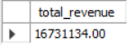
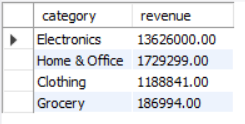
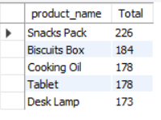
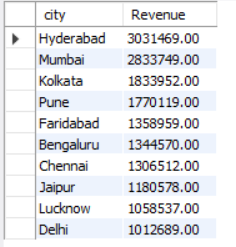
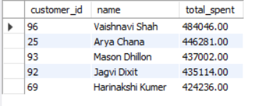
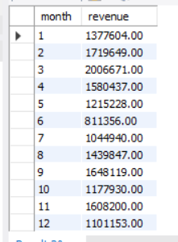
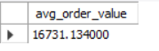
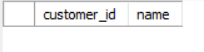

# SQL Sales Analysis Project

An end-to-end sales analysis project built with **MySQL** and **Python**. I generated a realistic sales dataset with Python, loaded it into a relational MySQL database, and answered 8 business questions using SQL (JOINs, GROUP BY, aggregate functions, LEFT JOIN).

---

## Objective

To find out where the money comes from: which categories, products, cities and customers drive revenue, and how sales behave over time.

## Tools Used

| Tool | Purpose |
|---|---|
| MySQL / MySQL Workbench | Database, tables, SQL analysis |
| Python (pandas, Faker) | Generating the sales dataset |

## Dataset

The dataset is synthetic (generated with Python), so the numbers are for practice and not real business data.

| Table | Rows | Columns |
|---|---|---|
| `customers` | 100 | customer_id, name, city |
| `products` | 20 | product_id, product_name, category, price |
| `orders` | 1,000 | order_id, customer_id, product_id, quantity, order_date |

**Relationships:** `orders.customer_id` links to `customers`, and `orders.product_id` links to `products`.

- **Categories:** Electronics, Clothing, Grocery, Home & Office
- **Cities:** 10 Indian cities
- **Order dates:** January 2025 to December 2025

## Business Questions

1. What is the total revenue generated?
2. Which category generates the most revenue?
3. Which are the top 5 best-selling products?
4. Which city generates the most revenue?
5. Who are the top 5 customers by spending?
6. How do sales change month by month?
7. What is the average order value?
8. Which customers have never placed an order?

## Key Insights

**1. Total revenue** was about **₹1.67 crore** (₹16,731,134) from 1,000 orders.

**2. Electronics dominates revenue.** It generated about **81%** of total revenue (₹1.36 crore), driven by high-priced items like laptops and smartphones. Grocery contributed only about 1%.

| Category | Revenue (₹) | Share |
|---|---|---|
| Electronics | 13,626,000 | ~81% |
| Home & Office | 1,729,299 | ~10% |
| Clothing | 1,188,841 | ~7% |
| Grocery | 186,994 | ~1% |

**3. Volume vs value.** Grocery items (Snacks Pack, Biscuits Box, Cooking Oil) are among the top 5 best-selling products by units, but they bring in very little revenue. High-volume, low-price products and low-volume, high-price products lead to very different outcomes.

| Product | Units sold |
|---|---|
| Snacks Pack | 226 |
| Biscuits Box | 184 |
| Cooking Oil | 178 |
| Tablet | 178 |
| Desk Lamp | 173 |

**4. Top cities.** Hyderabad (₹30.3 lakh) and Mumbai (₹28.3 lakh) together contributed about **35%** of total revenue. Hyderabad earned nearly 3x more than Delhi, the lowest-performing city (₹10.1 lakh).

**5. Top customers.** Vaishnavi Shah is the highest-spending customer with ₹4.84 lakh. The top 5 customers each spent between ₹4.24 lakh and ₹4.84 lakh.

**6. Monthly trend.** Revenue peaked in **March (₹20.07 lakh)** and was lowest in **June (₹8.11 lakh)**, a drop of about 60%. Sales recovered from July and rose again through September (₹16.48 lakh) and November (₹16.08 lakh), which suggests the business could plan promotions or stock around the weak mid-year months.

**7. Average order value** is about **₹16,731** per order.

**8. Customer activity.** Every one of the 100 customers placed at least one order, so the query for inactive customers returns no rows.

## Screenshots

| Question | Output |
|---|---|
| Q1: Total revenue |  |
| Q2: Category-wise revenue |  |
| Q3: Top 5 products |  |
| Q4: City-wise revenue |  |
| Q5: Top 5 customers |  |
| Q6: Monthly sales |  |
| Q7: Average order value |  |
| Q8: Customers with no orders |  |

## SQL Concepts Used

- `JOIN` (joining 2 and 3 tables)
- `LEFT JOIN` with `IS NULL`
- Aggregate functions: `SUM`, `COUNT`, `AVG`
- `GROUP BY`, `ORDER BY`, `LIMIT`
- Date function: `MONTH()`
- Table aliases and column aliases (`AS`)

## Project Structure

```
sql-sales-analysis/
├── data/
│   ├── customers.csv
│   ├── products.csv
│   └── orders.csv
├── screenshots/
├── generate_sales_data.py
├── csv_to_sql.py
├── project.sql
└── README.md
```

## How to Run

1. Install the libraries and generate the data:
   ```
   pip install faker pandas
   python generate_sales_data.py
   ```
   This creates the 3 CSV files in the `data/` folder.
2. Open `project.sql` in MySQL Workbench. It creates the `sales_analysis` database and the 3 tables.
3. Import the CSV files in this order: `customers`, `products`, `orders`. (If the Workbench import wizard fails, `csv_to_sql.py` can convert `orders.csv` into an INSERT script.)
4. Run the analysis queries (Q1 to Q8) in `project.sql` one by one.

## Author

**Rehan**, BCA Data Science student, aspiring Data Analyst
GitHub: [rehan2641](https://github.com/rehan2641)
